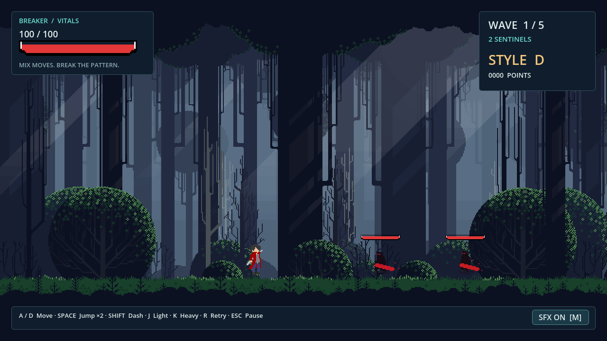
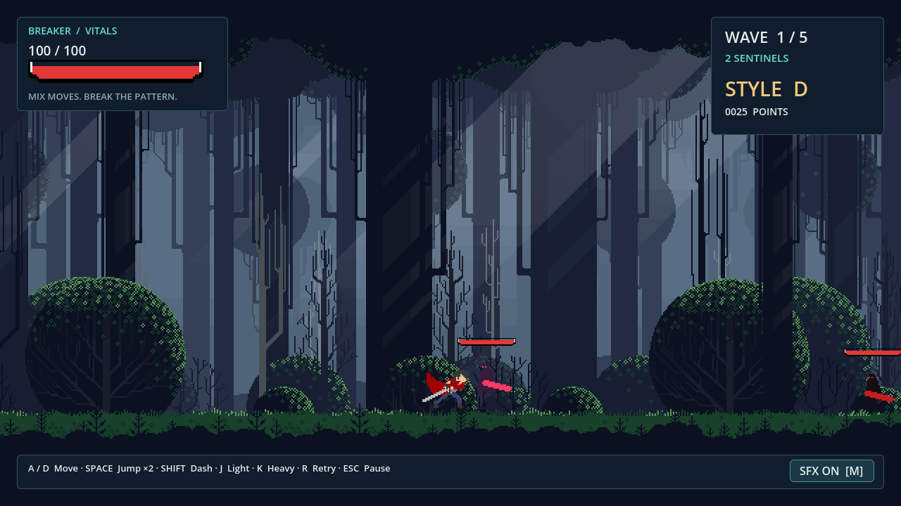
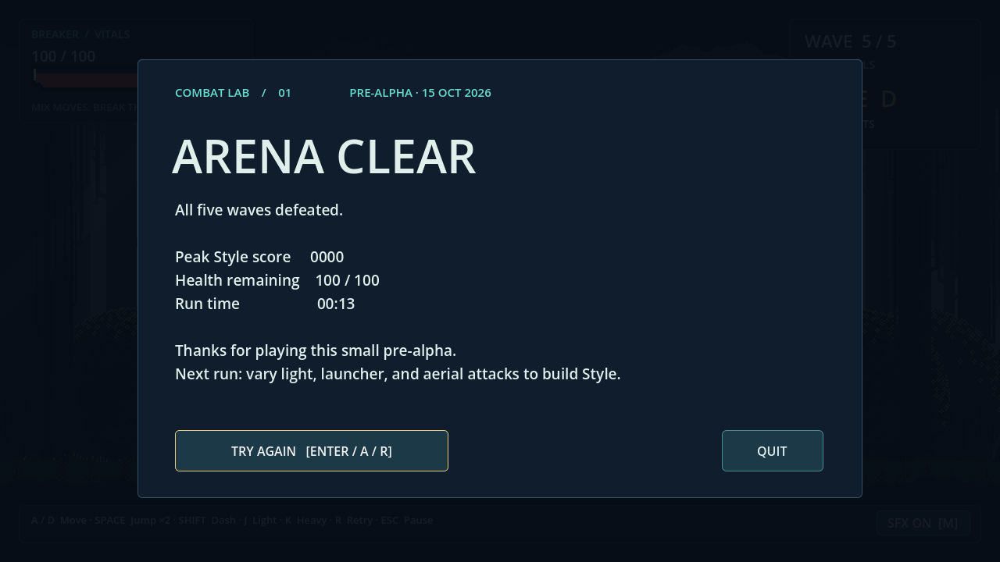

# Pixel-art arena integration — 15 October 2026

This branch adds a **playable local review scene**, `res://pixel_art/arena.tscn`. It inherits the existing arena and adds a presentation adapter. The five waves remain **2 / 3 / 3 / 4 / 5**. No new mechanics, artwork generation, main-scene change, merge or itch.io publication is included.

## Try it

1. Open the project with **Godot 4.6.3 stable** and let the import finish.
2. Open **`res://pixel_art/arena.tscn`** and press **F6 / Run Current Scene**. Enter/A starts the arena. The title lists keyboard and controller mappings. Move with A/D, double jump with Space, dash with Shift, light combo with J, launcher/air heavy with K. R retries; Esc pauses; M mutes; F11 toggles fullscreen.
3. **F5 still opens `res://levels/main.tscn`, the previous playable arena.** Reload/retry in the pixel scene stays in the pixel scene.
4. To inspect individual assets, use `res://preview/art_preview.tscn`. To compare background layers, Lights and bases, use `res://tests/background_preview.tscn`.

Command-line equivalent:

```sh
godot --path . pixel_art/arena.tscn
```

The `PixelPresentation` child's inspector exposes provisional player, enemy and health-bar toggles, plus a choice between the two uploaded background bases. These are review selections; no original artwork or uploaded alternative is deleted or modified. F5 is the complete fallback.

## Presentation and compatibility

| Area | Implementation / retained behavior |
|---|---|
| Player | Uploaded 80×48 sheets replace atlas textures in a **deep copy** of SpriteFrames. Every existing region, frame count, loop flag, speed, per-frame duration and AnimationPlayer/AnimationTree track is retained. Integer 2× scale and `(0,-48)` origin put frame bottom at actor feet. Jump/fall still use separate existing poses; ground/air chains and launcher use their original selected frames. |
| Enemies | Original enemy instances, scripts, Sprite2D node type, collision, AI and attack-token lifecycle remain. A child observes state and swaps 128×64 atlas regions from Sword.png. Idle 7, Run2 8, Attack 14, Hit 2, Death 9. Integer 2× scale, authored foot pivot `(32,51)`, mirrored pivot compensation. Existing damage flash, wave tint and telegraph remain. |
| Enemy timing | Visual attack anticipation maps to the existing **0.38 s windup**, contact begins with frame 8, then six recovery frames fit the existing **0.28 s recovery**. Source's 100 ms frame rate is used for idle/run/hit only. Death is compressed into the existing **0.18 s removal**, not prolonged. The adapter never deals damage, grants tokens or changes physics. |
| Forest | The preview's exact 12-texture/10-Parallax2D hierarchy and explicit camera-offset logic are extracted to **`pixel_art/forest_layers.tscn` / `.gd`** and used by both scenes. Full uploaded canvases, order and factors remain. Source row 723 aligns with world floor y=616 at 2× scale. Foreground stays behind combatants for legibility. Both opaque bases remain available; one is visible at a time. |
| Lights | Both uploaded white, low-alpha overlays stay with their respective depth group's art. Original normal mix/unshaded blending is retained; no generated lighting, bloom or replacement textures. |
| Camera/pixels | Nearest sampling, transform snapping, integer camera zoom, rounded positions and no camera smoothing. Runtime window resampling is temporarily disabled and restored on scene exit; `project.godot` is unchanged. Finite background, no invented seamless tiling. Camera clamps inside the authored canvas; integer zoom at larger windows trades view area for crisp pixels. |
| UI | Uploaded Pixel1 border region `(6,65,83,11)` and fill `(8,54,79,6)` become real TextureProgressBars. Border is not stretched; fill offset `(2,3)`, player 3× and enemy 1×. Existing HP text/score/wave/rank/results/pause/controller flows stay authoritative. Menu and HUD layout adapts without fractionally scaling pixel UI. |
| Feedback/audio | Existing hitstop, flash, warnings, confirmed-hit feedback and seven CC0 synthesized SFX remain. Uploaded character/enemy attack sheets supply their own pixel slash poses. No new VFX artwork, font, music or sound is generated. |

The core `actors/`, `combat/`, `levels/`, `systems/`, `ui/`, `resources/`, uploaded `assets/Art/`, and `project.godot` are byte-for-byte unchanged from base **808dd4d**. Existing regression tests gain only scene/screenshot arguments so the same combat checks can run against both arenas.

## Rights and release gate

**Do not publish the pixel version or distribute this source branch as a cleared asset collection.** User authorization to integrate uploads for review is not a third-party license grant. The user confirmed having source/license information; URLs/text have been requested and have not yet been supplied for verification.

| Material | Evidence and decision |
|---|---|
| Character PNGs, including unused options | All 19 hashes match historical `resources/Characters/Dante` inventory. No original creator URL/license/entitlement supplied. Verify both pack permission and any underlying character rights. **Public release blocked.** |
| Demon Sword PNG/Aseprite/examples | No supplied redistribution/game-use license or creator/source URL. Native source is not itself proof of rights. **Public release blocked.** |
| Adwit Rahman UI pack | Artist credit exists in filenames; no permission terms supplied. Credit alone does not grant game-use/source redistribution. **Public release blocked.** |
| Forest, Eder Muniz — “Free Pixel Art Forest” | All 12 hashes match the historical pack. Original license at Git commit `f3d6d48:resources/Environment/Free Pixel Art Forest/license.txt` permits personal/commercial game use and modification, requires attribution, and prohibits redistributing source assets, even modified. It describes itself as “closest” to CC BY 4.0; it is **custom terms, not plain CC BY or CC0**. Attribution for review: **Forest art by Eder Muniz**. Verify original provenance/current terms and compiled-game packaging before distribution; source bundle publication is not authorized by this grant. |
| Existing original art/VFX/SFX | CC0 per `resources/original/LICENSE.txt`; retained unchanged for fallback/feedback. No outside samples added. |
| Engine/font | Existing Godot MIT, bundled Noto Sans OFL and third-party notices remain in `docs/licenses`. No new font/plugin/runtime dependency. Development MCP addon remains disabled and excluded. |

Both existing export presets exclude **`pixel_art/*` and `assets/Art/*`**, alongside previews/tests/docs. Default public exports continue to use only the previous arena. A real Windows-preset **PCK-only** export was inspected: all **51 uploaded PNGs + 6 integration scene/script paths + 2 preview scene paths (59 total)** were absent, and original playable scene resources were present. No pixel release preset is enabled. Screenshots here are review evidence, excluded with `docs/*`; do not reuse as public marketing until rights are settled.

Earlier inventories and exact pack issues: [uploaded asset review](ART_ASSET_REVIEW_2026-10-15.md), [background review](BACKGROUND_PREVIEW.md), [historical asset audit](ASSET_AUDIT_2026-10-15.md).

## Actual validation

Tested on Linux with **Godot 4.6.3.stable.official.7d41c59c4**. Rendered checks used X11/OpenGL Compatibility, Mesa llvmpipe and Dummy audio. Logs are machine-local under `/tmp/stylebreaker-pixel/logs`.

| Test | Result |
|---|---|
| Headless editor import and scene smoke launch | Passed; final configured run has no script/resource/import errors. XDG cache/config/data paths point to writable `/tmp` directories. |
| Original arena regression | **47 checks, 0 failures**, real input/physics/timers/Area2D contacts, double jump, ground/air attacks, invulnerability/cancel, damage/Style, two-attacker cap, pause/hitstop, reload, five waves, victory/defeat. |
| Pixel arena headless regression | **47 checks, 0 failures**, identical suite/conditions. |
| Pixel arena rendered regression | **51 checks, 0 failures** with normal clock and `--max-fps 60`, including four actual captures. Separate `--fixed-fps 60` run also **51/0**. An initial concurrent uncapped software-rendered run failed **one combo-chain timing check**; both headless arenas passed, and subsequent controlled rendered runs passed. This does not establish hardware performance or excuse a future repeatable input failure. |
| Pixel compatibility/presentation validation | **55 headless / 57 rendered checks, 0 failures**. Compares all original frame regions/durations and physics shapes, fallback resource isolation, HP sync, ground/pivot alignment both facings, actual camera/parallax motion, Lights registration, runtime scaling restore and menu/sound-button visibility at 960×540, 1280×720, 1920×1080. |
| Shared background preview | **61 headless / 65 rendered checks, 0 failures**, including rendered Lights contribution and camera movement after extraction. |
| Existing asset inspector | **80 headless checks, 0 failures**; unchanged inspector/catalog still loads. Earlier rendered inspector results are historical, not rerun/claimed here. |
| Export isolation | Windows-preset `--export-pack` succeeded; external script verified **59 paths excluded**, original arena resources present. This is not executable/native Windows validation. Both presets' exclusion settings are checked by the presentation test. |
| Source integrity | No uploaded image/source/sidecar edited. All 19 character and 12 forest hashes matched the historical inventory. Core gameplay and project settings unchanged; `git diff --check` clean. |

No native Windows executable was built or run for this integration. No physical controller, native GPU, audible speaker/headphone output, Aseprite/PSD editing or human balance/performance playtest is claimed. Mesa reports the virtual display's unsupported V-Sync warning. Final tests report no script/resource errors or leaked instances.

## Reproduce

```sh
godot --headless --editor --path . --import --quit
godot --headless --path . --script tests/regression.gd
godot --headless --path . --script tests/regression.gd -- --scene res://pixel_art/arena.tscn
godot --headless --path . --script tests/pixel_art_validation.gd
godot --headless --path . --script tests/background_preview_validation.gd
godot --headless --path . --script tests/asset_preview_validation.gd
# Available desktop/display required; use an actual audio driver for manual listening.
godot --path . --audio-driver Dummy --max-fps 60 --script tests/regression.gd -- --scene res://pixel_art/arena.tscn --screenshots /tmp/stylebreaker-pixel/screenshots
godot --path . --audio-driver Dummy --script tests/pixel_art_validation.gd
godot --path . --audio-driver Dummy --script tests/background_preview_validation.gd
```

For PCK quarantine validation, create a JSON array of `res://` paths for all `assets/Art/**/*.png`, `pixel_art/*.gd`, `pixel_art/*.tscn` and the two preview scenes. Save it outside the project; then:

```sh
godot --headless --editor --path . --export-pack "Windows Desktop" /tmp/stylebreaker-pixel/windows.pck
godot --headless --main-pack /tmp/stylebreaker-pixel/windows.pck --script "$PWD/tests/pixel_art_pack_validation.gd" -- /tmp/stylebreaker-pixel/export-manifest.json
```

## Remaining limitations and assets

- **Rights are the release blocker.** Do not remove export exclusions until licenses, attribution and packaging are reviewed. No itch.io upload/publication is authorized by this work.
- Enemy PNG/source differ: AttackCombo 7 vs 8 frames, Death 9 vs 11. AttackCombo is unused; only nine supplied death poses are shown within existing removal time. No absent frames are invented. Player retains existing frozen defeat behavior rather than adding a new death sequence.
- Extra ground-chain/Dash poses, LungingStab, gun strips, TakeHit, alternate enemy locomotion and alternate UI widgets remain inspectable and unused. Adding them would need deliberate animation mapping; guns would change mechanics and are outside scope.
- Shared forest has finite nonmatching edges, so no infinite repeat is enabled. Camera framing differs from fallback to preserve integer pixels. Character/enemy pivots and exact artwork selection remain provisional.
- Smooth hit sparks/arcs/telegraph and standard text/menu panels are retained **existing placeholders** where no separate uploaded replacement is established. Pixel health bars and embedded attack FX are integrated; this is not a finished pixel UI/VFX skin. No music, new title illustration or additional enemy type is added.
- Tests use scripted lethal hits to advance later waves; they do not prove a human can clear all waves or certify balance. Manual keyboard/controller, native Windows and hardware performance/audio checks remain before release.

## Screenshots from the tested scene





Title and camera-right captures are alongside these files. They are unedited Godot viewport captures, not generated artwork or a promised public release build.

## Review branch and PR status

Implementation committed as **e5fb0fc** on **`integration/pixel-art-arena`**, based on `origin/main` at `808dd4d`, and pushed successfully. `gh pr create` was attempted with [the prepared description](PIXEL_ART_PR.md), including screenshots and validation. GitHub returned `Post "https://api.github.com/graphql": Forbidden`; this environment could not create the PR. [Open a separate review PR](https://github.com/dekiencute/2d_hack_and_slash/compare/main...integration/pixel-art-arena?expand=1) using that description. No PR was merged and nothing was published to itch.io.
